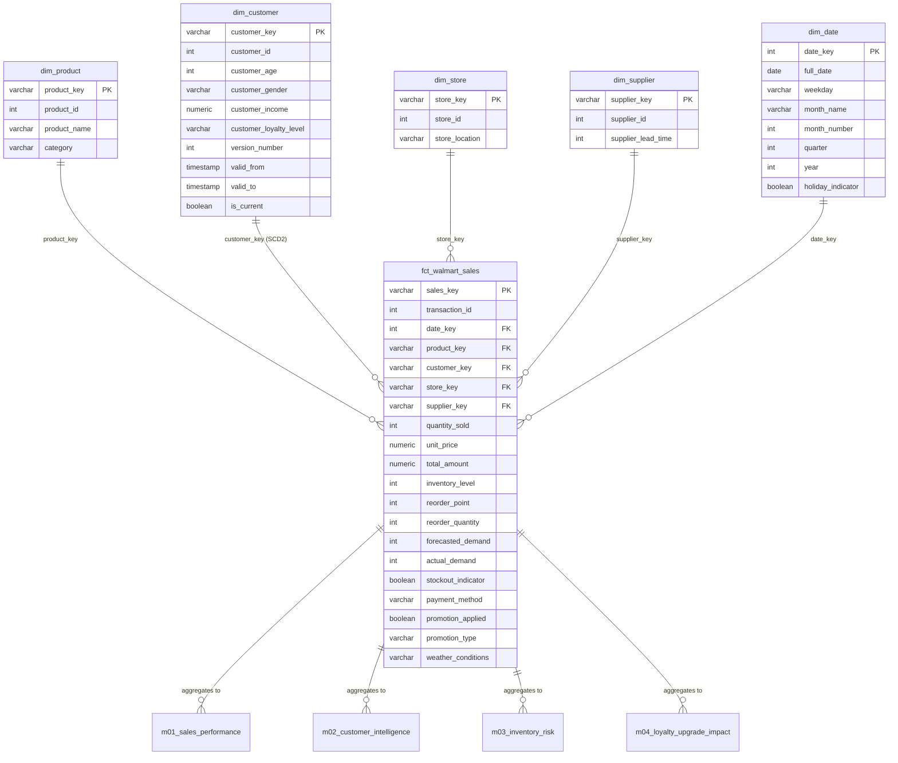

# 🏬 Walmart Supercenter Data Warehouse

คลังข้อมูลและการวิเคราะห์ธุรกิจสำหรับ Walmart Supercenter โดยใช้สถาปัตยกรรม **Modern Data Stack** (PostgreSQL 16 + dbt Core + Metabase + Docker Compose) ตามมาตรฐานหลักสูตร DSBA8 KMITL

---

## 🧰 Tech Stack & Ports Overview

| บริการ | Container Name | URL / Port | ข้อมูลเข้าใช้งาน (Credentials) |
| :--- | :--- | :--- | :--- |
| **PostgreSQL 16** | `wmt_postgres` | `localhost:35432` | User: `dw_user` / Pass: `dw_pass` / DB: `walmart_dw` |
| **pgAdmin 4** | `wmt_pgadmin` | [http://localhost:38880](http://localhost:38880) | Email: `dw_user@mail.com` / Pass: `dw_pass` |
| **Metabase (BI)** | `wmt_metabase` | [http://localhost:33000](http://localhost:33000) | Setup ครั้งแรกผ่านหน้าเว็บ |
| **dbt Core** | `wmt_dbt` | Container CLI / Port `38088` (Docs) | รันผ่านคำสั่ง Docker Exec |

---

## 🚀 วิธีเริ่มต้นใช้งาน (Quick Start)

### 1. รัน Container ทั้งหมด

**ถ้าเคยตั้งค่า Metabase แล้ว:** ทำขั้นตอนย้ายข้อมูลด้านล่างก่อนใช้ Compose เวอร์ชันนี้ เพื่อเก็บบัญชี Questions และ Dashboards เดิม
เปิด Terminal ในโฟลเดอร์โปรเจกต์นี้ (`walmart-datawarehouse`) แล้วรันคำสั่ง:

```bash
docker compose up -d
# หรือใช้ make up
```

ตรวจสอบสถานะให้ทุกคอนเทนเนอร์ขึ้น **Up / Running**:
```bash
docker compose ps
```

*(หมายเหตุ: ไฟล์ `init_db/01_init_raw.sql` จะสร้างตาราง `raw_walmart_sales` และโหลดข้อมูลจาก `raw_data/walmart_sales_v2.csv` ให้โดยอัตโนมัติเมื่อเริ่ม Container เป็นครั้งแรก — ถ้าเคยรันมาก่อนและต้องการโหลดข้อมูลใหม่ ให้ลบ volume ด้วย `docker compose down -v` แล้วค่อย `up -d` อีกครั้ง)*

---

### 2. รัน dbt Pipeline (Transform & Testing)

#### 2.1 ตรวจสอบการเชื่อมต่อ
```bash
docker exec -it wmt_dbt bash -c "cd walmart_dw && dbt debug"
```

#### 2.2 สร้างโมเดลทั้งหมด (Staging -> Dimensions -> Fact -> Metrics / Summary)
```bash
docker exec -it wmt_dbt bash -c "cd walmart_dw && dbt run"
```

#### 2.3 ตรวจสอบคุณภาพข้อมูล (Data Quality Tests)
ทดสอบ `unique`, `not_null`, `accepted_values` (ค่าที่ผ่านการทำความสะอาดแล้ว), `relationships` (Foreign Keys) และ `tests/assert_fact_attributes_match_source.sql` (attribute ใน dimension ตรงกับข้อมูลต้นทาง):
```bash
docker exec -it wmt_dbt bash -c "cd walmart_dw && dbt test"
```

#### 2.4 สร้างเอกสารและเปิดดูคู่มือคลังข้อมูล (dbt Docs)
```bash
docker exec -it wmt_dbt bash -c "cd walmart_dw && dbt docs generate"
docker exec -it wmt_dbt bash -c "cd walmart_dw && dbt docs serve --port 8080 --host 0.0.0.0"
```
เปิดดูเอกสารผ่านเบราว์เซอร์ได้ที่: [http://localhost:38088](http://localhost:38088)

---

### ย้ายข้อมูล Metabase เดิมเข้า persistent volume (ครั้งเดียว)

สำหรับเครื่องที่เคยรัน Metabase โดยไม่มี volume และยังใช้ค่าเริ่มต้น `/metabase.db` ให้สำรองฐานข้อมูลขณะหยุด Metabase **ก่อน pull และก่อนสร้าง container ใหม่** ตัวอย่าง PowerShell บน Windows:

```powershell
# รันในโฟลเดอร์โปรเจกต์ก่อน git pull
$metabaseBackup = Join-Path $PWD (".metabase-backup/" + (Get-Date -Format "yyyyMMdd-HHmmss"))
New-Item -ItemType Directory -Path $metabaseBackup -Force | Out-Null
docker stop wmt_metabase
docker cp wmt_metabase:/metabase.db/. "$metabaseBackup"
Get-ChildItem -LiteralPath $metabaseBackup
```

ตรวจว่ามี `metabase.db.mv.db` และทุกคำสั่งสำเร็จก่อนทำต่อ หากสำรองไม่สำเร็จ ให้ `docker start wmt_metabase` แล้วตรวจตำแหน่งฐานข้อมูลเดิมก่อน ห้ามสร้าง container ทับตัวเดิม

```powershell
git pull --ff-only
# สร้าง container ใหม่พร้อม volume แต่ยังไม่เริ่ม Metabase
docker compose create metabase
docker cp "$metabaseBackup/." wmt_metabase:/metabase-data/metabase.db
# ให้ UID/GID เริ่มต้นของ Metabase (2000:2000) อ่าน/เขียนไฟล์ได้
docker compose run --rm --no-deps --user root --entrypoint sh metabase -c "chown -R 2000:2000 /metabase-data"
docker compose up -d metabase
Invoke-RestMethod http://localhost:33000/api/health
```

รอจน health เป็น `ok` แล้วล็อกอินด้วยบัญชีเดิมและตรวจ Questions/Dashboards ที่ [Metabase](http://localhost:33000) เก็บสำเนาสำรองไว้จนยืนยันครบ หากหน้า Setup ปรากฏแทนหน้าล็อกอิน ให้หยุด Metabase และตรวจไฟล์ที่คัดลอกก่อนสร้างบัญชีใหม่

Compose นี้ใช้ `MB_DB_FILE=/metabase-data/metabase.db` ซึ่งใน image ที่ทดสอบเก็บไฟล์ H2 ที่ `/metabase-data/metabase.db/metabase.db.mv.db` หากใช้ image/ตำแหน่งฐานข้อมูลต่างออกไป ให้ตรวจ path จริงก่อนย้าย เครื่องใหม่ที่ยังไม่มีข้อมูล Metabase ข้ามขั้นตอนนี้ได้

`docker compose down` เก็บ named volumes ไว้ แต่ `docker compose down -v` / `make down-v` ลบทั้งฐานข้อมูลคลังข้อมูลและข้อมูล Metabase จึงไม่ใช้คำสั่งนี้สำหรับ restart ปกติ สำเนาสำรองมีข้อมูลบัญชีและการเชื่อมต่อ ควรเก็บเฉพาะในเครื่อง (`.metabase-backup/` ถูก ignore)

---

### 3. รันผ่าน Shortcut (Makefile)
สามารถสั่งการผ่านคำสั่ง `make` ได้สะดวกยิ่งขึ้น:
- `make up` : รัน Docker Compose ทั้งหมด
- `make down` : หยุดการทำงาน Container
- `make dbt-run` : สั่งรันโมเดล dbt ทั้งหมด
- `make dbt-test` : สั่งรัน Data Tests ทั้งหมด
- `make dbt-docs` : สร้าง dbt Docs
- `make dbt-serve`: สั่งเปิด web server ให้ dbt Docs บนพอร์ต 38088

---

## 🗂️ ข้อมูลต้นทาง (Source Data)

| ไฟล์ | คำอธิบาย |
| :--- | :--- |
| `raw_data/Walmart.csv` | ข้อมูลต้นฉบับ 5,000 แถว (เก็บไว้อ้างอิง ไม่ได้ใช้ใน pipeline) |
| `raw_data/walmart_sales_v2.csv` | ข้อมูลที่ใช้จริง 50,000 transactions ตลอดปี 2024 สร้างจาก `generate_data.py` |

### ทำไมต้องสร้างข้อมูลใหม่
ข้อมูลต้นฉบับถูกสุ่มแยกทีละคอลัมน์ จึงขัดแย้งกันเองและไม่มีรูปแบบทางธุรกิจให้วิเคราะห์ เช่น
- `product_id` / `store_id` / `customer_id` เดียวกันมีหลายชื่อ หลายเมือง หลายระดับสมาชิก
- `holiday_indicator` ไม่คงที่ภายในวันเดียวกัน (ทั้ง 260 วัน) และ `weekday` ไม่ตรงกับวันที่จริง 85%
- สินค้าอยู่ผิดหมวด (Fridge เป็น Electronics), ราคาไม่ขึ้นกับสินค้า, `stockout_indicator` ไม่สัมพันธ์กับสต็อก, `promotion_applied` ขัดกับ `promotion_type`, forecast กับ actual demand ไม่สัมพันธ์กัน (r ≈ 0)

### ข้อมูลใหม่ (`generate_data.py`)
สคริปต์ใช้ seed คงที่ (รันซ้ำได้ไฟล์เดิมทุกครั้ง) ใช้ Python standard library เท่านั้น และคง 28 คอลัมน์/รูปแบบเดิม:
- **Master data คงที่:** 265 สินค้า (8 ประเภท, หมวดถูกต้อง, ช่วงราคาสมจริง), 20 สาขา (เมืองละ 4), ~8,000 ลูกค้า, 60 supplier
- **ปฏิทิน:** ทั้งปี 2024, ฤดูกาล (พ.ย.–ธ.ค. สูงสุด), วันหยุดสุดสัปดาห์, วันหยุดราชการสหรัฐฯ และ Black Friday
- **ลูกค้าเลื่อนระดับสมาชิกระหว่างปี (SCD Type 2):** ~12% ของลูกค้าที่ไม่ใช่ Platinum เลื่อนขึ้น 1 ระดับในช่วง มี.ค.–ต.ค. และหลังเลื่อนจะซื้อบ่อยขึ้นตามระดับใหม่
- **ความสัมพันธ์ทางธุรกิจ:** โปรโมชันเพิ่มจำนวนชิ้น, ลูกค้าระดับสูงซื้อบ่อยกว่า, supplier lead time ยาวและวันหยุด (ดีมานด์เกินพยากรณ์) ทำให้ของขาดสต็อกมากขึ้น, สภาพอากาศแย่ลดจำนวนลูกค้า
- **ข้อมูลสกปรกโดยเจตนา (~2% ต่อประเภท)** ให้ชั้น staging ทำความสะอาด: ช่องว่าง/แท็บ, ตัวพิมพ์เล็ก-ใหญ่, รูปแบบ `City, ST` ไม่สม่ำเสมอ, ค่าว่าง (เพศ อายุ ประเภทโปรโมชัน), วันที่แบบ ISO, ราคาแบบ `$1,234.56`, boolean แบบ `Yes/No/1/0`, แถวซ้ำ

```bash
python generate_data.py                    # ค่าเริ่มต้น: 50,000 แถว, dirty 2%
python generate_data.py --dirty-rate 0     # ข้อมูลสะอาด
```

### การทำความสะอาดใน `stg_walmart_sales`
ลบแถวซ้ำด้วย `transaction_id`, ตัดช่องว่าง (macro `clean_text`), ปรับตัวพิมพ์ด้วย `initcap`, จัดรูปแบบ `store_location`, แปลงวันที่ทั้งสองรูปแบบ, ตัด `$` และ `,` ออกจากราคา, แปลง boolean ทุกรูปแบบ (macro `clean_bool`), เติมเพศ/อายุที่หายจากรายการอื่นของลูกค้าคนเดียวกัน (ถ้าเติมไม่ได้: เพศ = `Unknown`, อายุคงเป็น null และ test จะแจ้งเตือน), `promotion_type` ว่าง/`None` → `No Promotion`, คำนวณ `weekday` จากวันที่แทนค่าในไฟล์

---

## 📐 สถาปัตยกรรมแบบจำลองข้อมูล (Star Schema)



- **Grain ของ Fact:** 1 แถว ต่อ 1 รายการขายในใบเสร็จ (`sales_key` เป็น Surrogate Key)
- **Fact Table:** `fct_walmart_sales`
  - Measures: `quantity_sold`, `unit_price`, `total_amount`, `inventory_level`, `reorder_point`, `forecasted_demand`, `actual_demand`
- **Dimension Tables:**
  - `dim_product`: สินค้าและหมวดหมู่
  - `dim_customer`: อายุ เพศ รายได้ และระดับสมาชิก — **SCD Type 2** (1 แถวต่อ 1 เวอร์ชันของลูกค้า มี `valid_from` / `valid_to` / `is_current`); fact เชื่อมกับเวอร์ชันที่มีผล ณ เวลาที่ซื้อ
  - `dim_store`: รหัสและทำเลที่ตั้งสาขา
  - `dim_supplier`: รหัสและระยะเวลาจัดส่งสินค้าเฉลี่ย
  - `dim_date`: ปฏิทิน วันในสัปดาห์ เดือน ไตรมาส ปี และวันหยุด
- **Metric Layer:**
  - `m01_sales_performance`: ยอดขายรวม, ปริมาณขาย, และ AOV แยกตามสาขาและโปรโมชัน
  - `m02_customer_intelligence`: พฤติกรรมการซื้อและ AOV แยกตามระดับสมาชิก
  - `m03_inventory_risk`: อัตราสินค้าขาดสต็อกและความคลาดเคลื่อนของการพยากรณ์ดีมานด์
  - `m04_loyalty_upgrade_impact`: ยอดใช้จ่ายต่อ 30 วันหลังเลื่อนระดับ เทียบกับกลุ่มควบคุม (ลูกค้าระดับเดิมที่ไม่ได้เลื่อน ในช่วงเวลาเดียวกัน)
- **Summary Layer:** `smt_sales_summary` — ROLLUP ของปี/ไตรมาส/เดือน ร่วมกับ CUBE ของทำเล/หมวดสินค้า พร้อมยอดย่อยและยอดรวมทุกระดับ

---

### SCD Type 2 ของ `dim_customer`
ข้อมูลต้นทางไม่มีตารางประวัติการเปลี่ยนแปลงของลูกค้า จึงสร้างประวัติจากรายการขายเอง (gaps-and-islands): เมื่อ attribute ของลูกค้าต่างจากรายการก่อนหน้า ถือเป็นเวอร์ชันใหม่ โดย `valid_from` = เวลาของรายการแรกที่เห็นค่าใหม่ (วันที่เปลี่ยนจริงอยู่ระหว่างรายการสุดท้ายของเวอร์ชันเก่ากับรายการแรกของเวอร์ชันใหม่) เวอร์ชันแรกเริ่มที่ `1900-01-01`
- ไม่ใช้ `dbt snapshot` เพราะ snapshot บันทึกการเปลี่ยนแปลง*ระหว่างรอบการรัน* แต่ประวัติของโปรเจกต์นี้อยู่ในไฟล์เดียวอยู่แล้ว
- `tests/assert_customer_scd2_versions_valid.sql` ตรวจว่าลูกค้าทุกคนมี current version เดียว และช่วงเวลาต่อกันไม่ขาดไม่ซ้อน
- `m04` วัดเฉพาะช่วง*หลัง*เลื่อนระดับ (ไม่นับรายการแรกที่ทำให้เห็นการเปลี่ยน) เพราะช่วงก่อนเลื่อนมี bias จากวิธีหาวันเปลี่ยน และเทียบกับกลุ่มควบคุมในช่วงเวลาเดียวกันเพื่อตัดผลของฤดูกาล

---

## 📊 การเชื่อมต่อ Metabase เพื่อสร้าง Dashboard

1. เข้าเบราว์เซอร์ไปที่: [http://localhost:33000](http://localhost:33000)
2. ทำตามขั้นตอนตั้งค่าเริ่มต้นของ Metabase (สร้างแอดมิน)
3. เลือกเพิ่มฐานข้อมูล (**Add your data**):
   - **Database type:** PostgreSQL
   - **Host:** `postgres`
   - **Port:** `5432`
   - **Database name:** `walmart_dw`
   - **Database username:** `dw_user`
   - **Database password:** `dw_pass`
4. สร้าง Dashboards และ Visualizations ตอบโจทย์ KPIs 4 ด้านสำคัญได้ทันที:

| Dashboard / คำถามทางธุรกิจ | ตารางข้อมูลที่ใช้ | รูปแบบ Visualization ที่แนะนำ |
| :--- | :--- | :--- |
| **1. Sales Performance & Promotion Effect** | `m01_sales_performance` | - **Line Chart:** แนวโน้มรายได้รายเดือนแยกตาม Category<br>- **Bar Chart:** ยอดขายและ AOV ตามประเภท Promotion |
| **2. Customer Intelligence & Loyalty** | `m02_customer_intelligence` | - **Pie / Donut Chart:** สัดส่วนยอดใช้จ่ายแยกตาม Loyalty Level (จำนวนลูกค้าให้นับ distinct จาก Fact)<br>- **Bar Chart:** วิธีการชำระเงินยอดนิยมในแต่ละสาขา |
| **3. Inventory & Supply Chain Risk** | `m03_inventory_risk` | - **Table / Heatmap:** Stockout Rate (%) แยกตาม Store Location และ Category<br>- **Scatter / Bar:** ความคลาดเคลื่อน Forecast Variance เทียบกับ Lead Time |
| **4. Loyalty Upgrade Impact (SCD2 Uplift)** | `m04_loyalty_upgrade_impact` | - **Bar Chart:** Uplift vs Control (%) เมื่อลูกค้าเลื่อนขั้น (Bronze -> Silver, Silver -> Gold, Gold -> Platinum)<br>- **Metric Card:** Average Spend ต่อ 30 วันหลัง Upgrade |


### กฎการรวมตัวเลขสำหรับ Dashboard

- **จำนวนลูกค้า:** `unique_customers` ใน m02 เป็น distinct ภายในแต่ละกลุ่ม (ระดับสมาชิก × เพศ × วิธีชำระเงิน × ทำเล) ห้าม SUM ข้ามกลุ่ม เพราะลูกค้าคนเดียวปรากฏได้หลายกลุ่ม หากต้องการจำนวนลูกค้าของช่วง/กลุ่มใหม่ ให้นับ `count(distinct c.customer_id)` จาก Fact ที่ join กับ `dim_customer` ตาม `customer_key` และใช้ตัวกรองที่ต้องการ ลูกค้าที่เปลี่ยนระดับระหว่างปีอาจอยู่หลายระดับ จึงไม่ควรใช้สัดส่วนจำนวนลูกค้าแต่ละระดับเป็น donut ของลูกค้าที่ไม่ซ้ำทั้งปี
- **AOV:** รวมใหม่ด้วย `sum(total_revenue) / nullif(sum(total_transactions), 0)` สำหรับ m01 หรือ `sum(total_spent) / nullif(sum(total_transactions), 0)` สำหรับ m02 ไม่ใช้ SUM/AVG ของ `aov` รายกลุ่ม ปัจจุบันต้นทางมีหนึ่งรายการต่อ transaction; หากอนาคตมีหลาย line items ต่อบิล ต้องนับ distinct transaction จาก Fact สำหรับกลุ่มใหม่
- **Stockout rate:** ใช้ `100.0 * sum(stockout_events) / nullif(sum(total_events), 0)` ไม่เฉลี่ยเปอร์เซ็นต์รายกลุ่มตรง ๆ โดยตัวหารเป็นรายการขาย ไม่ใช่จำนวน SKU ทุกวัน
- **m04:** แสดงค่ารายคู่ระดับสมาชิกโดยตรง ไม่บวกหรือเฉลี่ย `uplift_vs_control` และยอดต่อ 30 วันข้ามคู่ระดับโดยไม่มีตัวถ่วงน้ำหนัก


## Week 8: Grain, ROLLUP/CUBE และ Summary Table (Issue #2)

### Grain: หนึ่งแถวแทนอะไร

รายละเอียดเดียวกันบันทึกใน `dbt/walmart_dw/models/schema.yml` และแสดงใน dbt Docs:

| Model | Grain / คอลัมน์กำหนดหนึ่งแถว |
| :--- | :--- |
| `stg_walmart_sales` | หนึ่งรายการขายต่อ `transaction_id` หลัง deduplicate; ข้อมูลปัจจุบันมีหนึ่งสินค้าในแต่ละ transaction |
| `dim_product` | หนึ่งชุด `(product_id, product_name, category)` |
| `dim_store` | หนึ่งชุด `(store_id, store_location)`; หนึ่งทำเลมีหลายสาขา |
| `dim_customer` | หนึ่ง `(customer_id, version_number)` ตามช่วง `[valid_from, valid_to)` แบบ SCD2 |
| `dim_supplier` | หนึ่งชุด `(supplier_id, supplier_lead_time)` |
| `dim_date` | หนึ่งวันที่พบในข้อมูลขาย ไม่ใช่ date spine ที่เติมวันไม่มีการขาย |
| `fct_walmart_sales` | หนึ่งรายการขาย กำหนดด้วย `sales_key` จาก transaction/product/timestamp |
| `m01_sales_performance` | ปี × เดือน × หมวดสินค้า × ทำเล × สถานะวันหยุด × ประเภทโปรโมชัน |
| `m02_customer_intelligence` | ระดับสมาชิก × เพศ × วิธีชำระเงิน × ทำเล ตลอดช่วงข้อมูล |
| `m03_inventory_risk` | ทำเล × หมวดสินค้า × สภาพอากาศ ตลอดช่วงข้อมูล |
| `m04_loyalty_upgrade_impact` | หนึ่งคู่ระดับสมาชิก `(from_tier, to_tier)` |
| `smt_sales_summary` | `grouping_id` × ค่ามิติที่คงอยู่ใน `(year, quarter, month_number, store_location, category)` |

### โครงสร้าง Summary

Summary เป็นตาราง aggregate จาก Fact เดิม ไม่ใช่เหตุการณ์ธุรกิจใหม่ จึงไม่เพิ่ม fact อิสระ โดยใช้:

```sql
GROUP BY ROLLUP(year, quarter, month_number), CUBE(store_location, category)
```

- `time_grain`: `month` → `quarter` → `year` → `all_time` เป็นลำดับ ROLLUP
- `dimension_grain`: `location_category`, `location`, `category`, `all_dimensions` เป็นสี่ชุดของ CUBE
- รวมเป็น **16 ชุดระดับสรุป** จำนวนแถวจริงขึ้นอยู่กับข้อมูล (ข้อมูลจำลองปี 2024 ปัจจุบันได้ 324 แถว)
- `grouping_id = GROUPING(year, quarter, month_number, store_location, category)` ใช้ bit 16/8/4/2/1 ตามลำดับ; bit เป็น 1 หมายถึงมิตินั้นถูกยุบรวม ค่า 31 คือ Grand Total
- มิติที่ยุบรวมมีค่า NULL; ค่าที่เป็น NULL จริงในข้อมูลอาจเกิดได้เช่นกัน ให้ใช้ grouping bits/grain แยกความหมาย ห้ามใช้ `IS NULL` เพียงอย่างเดียวระบุ subtotal
- `summary_key` รวม grouping bits และค่ามิติทั้งหมด จึงแยกแถวที่ถูกยุบรวมออกจากแถว NULL จริงได้
- Measures: `total_revenue`, `total_units_sold`, `total_transactions` (distinct transaction ที่แต่ละ grain), `aov` (ยอดขาย ÷ จำนวนบิล คำนวณใหม่จาก Fact ทุกระดับ)
- ถ้า Fact ว่าง จะมี Grand Total หนึ่งแถว ยอดขาย/จำนวนชิ้น/จำนวนบิลเป็น 0 และ AOV เป็น NULL

### ตัวอย่าง Roll-up / Drill-down สำหรับ Metabase

เลือก **หนึ่ง `time_grain` และหนึ่ง `dimension_grain`** ก่อนใช้ตาราง เพราะหลายระดับครอบคลุมรายการขายชุดเดียวกัน ห้าม SUM ทั้งตาราง

```sql
-- Grand Total เพียงแถวเดียว
SELECT total_revenue, total_units_sold, total_transactions, aov
FROM smt_sales_summary
WHERE grouping_id = 31;

-- Roll-up: ยอดขายรวมทุกทำเล/หมวดสินค้าแยกปี
SELECT year, total_revenue, total_transactions, aov
FROM smt_sales_summary
WHERE time_grain = 'year' AND dimension_grain = 'all_dimensions'
ORDER BY year;

-- Drill-down: ปี 2024 ลงสู่ไตรมาส
SELECT year, quarter, total_revenue, aov
FROM smt_sales_summary
WHERE time_grain = 'quarter' AND dimension_grain = 'all_dimensions'
  AND year = 2024
ORDER BY year, quarter;

-- Drill-down: ไตรมาส 1 ลงสู่เดือน รักษา year/quarter context
SELECT year, quarter, month_number, total_revenue, aov
FROM smt_sales_summary
WHERE time_grain = 'month' AND dimension_grain = 'all_dimensions'
  AND year = 2024 AND quarter = 1
ORDER BY month_number;

-- CUBE: แต่ละทำเลรวมทุกหมวดสินค้าในปี 2024
SELECT store_location, total_revenue, total_transactions, aov
FROM smt_sales_summary
WHERE time_grain = 'year' AND dimension_grain = 'location' AND year = 2024
ORDER BY total_revenue DESC;

-- CUBE: หมวดสินค้ารวมทุกทำเลในปีเดียวกัน
SELECT category, total_revenue, total_transactions, aov
FROM smt_sales_summary
WHERE time_grain = 'year' AND dimension_grain = 'category' AND year = 2024
ORDER BY total_revenue DESC;
```

Summary นี้รองรับทำเล (เมือง), หมวดสินค้า และเวลา ไม่มีระดับ store_id, รายวัน, สมาชิก หรือโปรโมชัน หากต้องการตัวกรองเหล่านั้นให้ใช้ Fact/metric ที่มี grain รองรับ อัตราและ distinct counts ไม่ใช่ additive measures: เลือกแถว subtotal ที่ต้องการหรือคำนวณใหม่จาก Fact; ห้ามเฉลี่ย AOV รายแถว หากอนาคตมีหลายสินค้าต่อบิล จำนวนบิลอาจซ้ำข้ามหมวดสินค้า แต่ Summary ยังคงนับ distinct ให้ถูกต้องแยกทุกระดับ

### การสร้างและตรวจสอบ

```bash
# สร้างทุกโมเดลและตรวจ tests รวม Summary
docker exec wmt_dbt bash -c "cd walmart_dw && dbt build"
# สร้างเฉพาะ Summary และตรวจ tests ของมัน (ต้องมี Fact/Dimensions แล้ว)
docker exec wmt_dbt bash -c "cd walmart_dw && dbt build --select smt_sales_summary"
# สร้างเอกสาร Grain/Lineage
docker exec wmt_dbt bash -c "cd walmart_dw && dbt docs generate"
```

- `assert_sales_summary_grand_total.sql`: ต้องมี Grand Total หนึ่งแถว และยอดขาย/ชิ้น/บิลตรงกับ Fact
- `assert_sales_summary_reconciles.sql`: เทียบทั้ง 16 ชุดระดับกับ GROUP BY จาก Fact โดยตรง รวม AOV และ grain labels; ตรวจพบยอดผิด แถวหาย หรือแถวเกิน ไม่ใช่เพียงเทียบยอดรวม
- `assert_sales_summary_grain.sql`: ต้องไม่ซ้ำใน grain ของแต่ละระดับ พร้อม generic tests สำหรับ summary key, grouping IDs, labels และ measures ที่ห้ามว่าง
